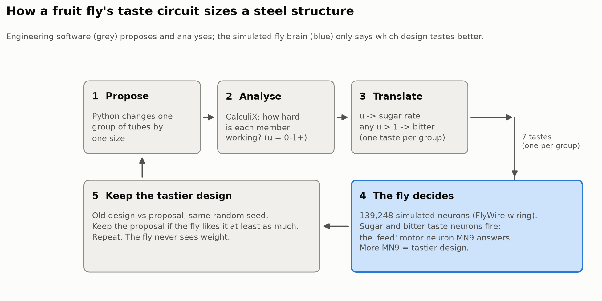

# What a fruit fly's taste buds can tell you about steel

A fruit fly lands on something and has to decide, in a fraction of a second, whether to eat it. Sugar says yes. Bitter says no, and a little bitterness beats a lot of sugar. That decision is made by a few hundred neurons in a brain the size of a poppy seed, and nobody designed it. Evolution did.

For the last few weeks I have been using that decision, running as a computer simulation, to size the steel members of an offshore wind-turbine foundation. This post is about the fly part: what the simulation actually is, how you ask it a question, what it turned out to be good and bad at, and what happened when I scrambled its wiring.

## The brain is a wiring diagram, run as physics

In 2024 the FlyWire consortium published the complete connectome of an adult fruit fly: every neuron (about 139,000) and every connection between them (about 2.7 million, after dropping the weakest ones). The same year, Philip Shiu and colleagues showed that a very simple simulation built straight from that diagram behaves like a fly in several ways. No training, no tuning of individual neurons. Just the wiring.

The simulation is easier to picture than the word "neural network" suggests. Each neuron is a leaky bucket with a tripwire. Electrical charge flows in from other neurons and slowly leaks out. If the level crosses a threshold, the neuron fires a single pulse to every neuron it connects to, empties, and rests for two milliseconds. Some connections fill the next bucket, some drain it, depending on the chemical the sending neuron uses. The size of each connection is simply the number of physical contacts counted in the brain scan. The whole thing is stepped forward every tenth of a millisecond.

To ask the fly a question, I make a group of its taste neurons fire at a chosen rate (129 sugar-sensing neurons and 65 bitter-sensing ones, as labelled in the FlyWire annotations), run one simulated second, and count how often one particular neuron fires: MN9, the motor neuron that extends the proboscis, the fly's feeding tube. One question takes about ten seconds on my laptop. I call it a poke.

The first thing I did was check I could reproduce the published result. Sugar at 150 pulses per second: MN9 fires at 150. Sugar plus bitter: 14. It matched exactly.

## Treat it like a sensor before trusting it

An engineer would never wire an uncalibrated gauge into a control loop, so I measured the fly first (Figure 1).

Sugar has a dead zone at the bottom, a steep middle and a ceiling around 150 Hz. Bitter works as a graded veto: the more bitter, the quieter MN9 gets, until it stops. And the answer is noisy. Ask the same question with a different random seed and it moves by 4 to 12 pulses per second.

The noise turned out to matter more than anything else in the project. Two designs have to differ by roughly ten pulses per second before the fly can reliably tell them apart. My first attempt to size the offshore structure failed because I had placed the "fully used" end of the scale on the flat top of the sugar curve. On a curve measured with one seed it looked fine. Measured properly, with five seeds, the top of the curve was flat, and the fly simply could not taste the difference between a heavy design and a slightly lighter one. Moving the scale onto the steep part fixed it. I think that is the most transferable lesson here: the fly is an instrument with a usable range, and you only find the range by measuring it.

## Turning a structure into a taste

The structure is a four-legged steel jacket, the lattice that holds an offshore wind turbine on the seabed, in 50 metres of water, under a 50-year storm and the turbine's own loads. The finite-element solver (CalculiX) tells me how hard every member is working, as a fraction of what it can carry. The members are sized in seven groups.

For each group I give the fly one taste: the harder the group works, the more sugar. If any member anywhere is overloaded, every taste gets a heavy dose of bitter, which silences MN9. A design's score is the sum of the seven MN9 readings. A simple search proposes a change, the solver analyses it, the fly tastes the old design and the new one on the same random seed, and the search keeps the new one if the fly likes it at least as much (Figure 2).

The fly is never told the weight. It prefers lighter designs for a reason that is entirely in its response curve: because sweetness saturates, the score gains most by making the least-used group work harder, and that is exactly how you remove unnecessary steel.

## It found the answer

There are about 2.1 million possible designs. Two conventional optimisers, a classic engineering resizing rule and a standard evolutionary algorithm, both converged on the same 339-tonne design. Starting from four different designs between 676 and 1,074 tonnes, the fly-guided search ended on that same design every time, and never once accepted a design with an overloaded member (Figure 3).

## Does the wiring matter?

This was the test I most wanted to run. I kept the fly's brain exactly the same size, kept every neuron, every connection strength and the number of connections into and out of every neuron, and randomly reconnected who talks to whom. Then I asked the same questions.

The rewired brains did nothing. With sugar at 40, 80 or 150 pulses per second, MN9 stayed at zero, in three separately shuffled brains. The intact brain answered 67, 125 and 151. Used as a judge in the search, a silent brain scores every design zero, so the search accepts everything, including overloaded designs. On a test truss it ended on an unsafe design in nearly half the runs.

So the "eat or reject" behaviour is not something a big random network does anyway. It is in the particular way these neurons are connected.

## What the fly is actually contributing

To be fair to the engineering, I also replaced the fly with simpler judges and ran the identical search.

I ran the identical search with four stand-ins for the fly: a smooth curve copied from the fly's measured response, the same curve with the fly's measured noise added, a plain straight-line score, and the rewired brain. Twenty starting designs each, on both the truss and the jacket (Figure 4).

Two things came out clearly. First, most of the work is done by the suggestions the search makes, not by the judge. When the search proposes sensible moves based on the structural analysis ("shrink the group with the most spare capacity"), almost any judge that keeps the never-overload rule finds the truss optimum, in 85 to 90 percent of runs. When the moves are random, nothing does well. The real fly with random moves on the jacket ended between 392 and 607 tonnes after 80 rounds, 16 to 79 percent heavier than the best design, when the same fly with guided moves reached 339 tonnes from all four starts. It still never accepted an overloaded design.

Second, the shape of the fly's response helps a little and the veto helps a lot. On the jacket, the fly-shaped curves beat the straight line (40 to 45 percent of runs against 25), which is what you would expect if saturation is what pushes the search toward lifting the laziest member group. The rewired brain has no veto at all, and it ended on an overloaded structure in about two thirds of jacket runs.

The honest summary: in this setup the fly behaves like a noisy, saturating preference with a built-in veto. Once you have measured its response curve, a few lines of code reproduce most of what it does. What you cannot do is write those lines without having measured a fly first, and that, to me, is the point of the exercise: the rule was evolved, not designed, and it happens to be a sensible rule for structural steel.

## What this is not

It is not a better optimiser. Each taste costs ten seconds; a classic engineering rule reaches the same design in three analyses. The suggestions the search makes are informed by the structural analysis, and they do much of the work. It is a static check only: no fatigue, no joint checks, no dynamics, all of which matter for real offshore structures. And it is a model of one female fly's wiring, with predicted neurotransmitters and simple neurons.

What it is: a working, measurable example of an evolved biological decision circuit plugged into an engineering workflow, with every simulated neuron recording logged, and a control experiment showing that the wiring is what makes it work.

Code, CalculiX models, every logged poke and the full technical report: [link]
