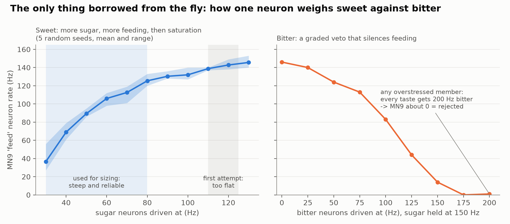
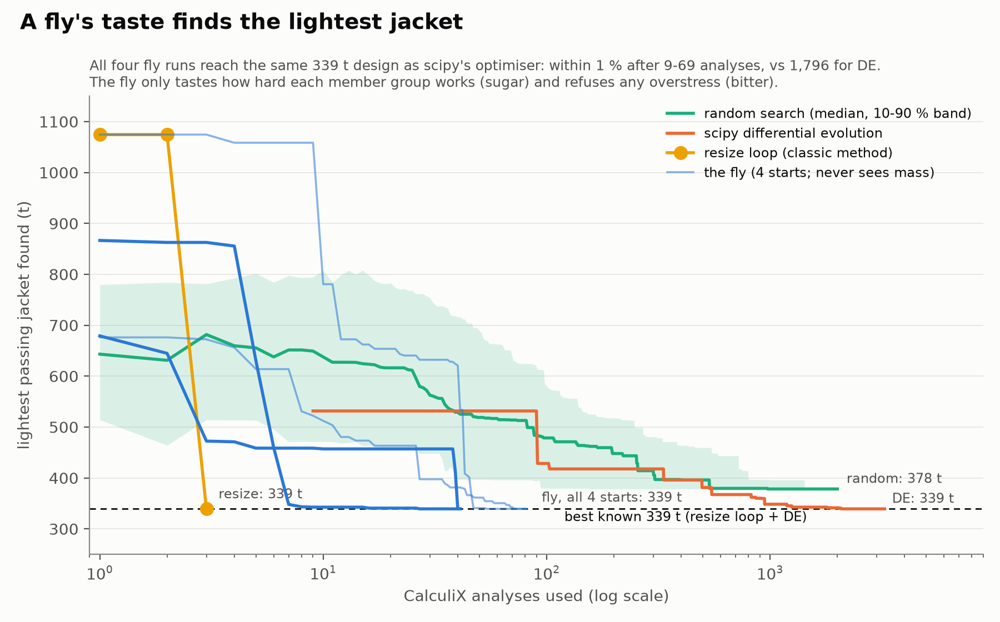
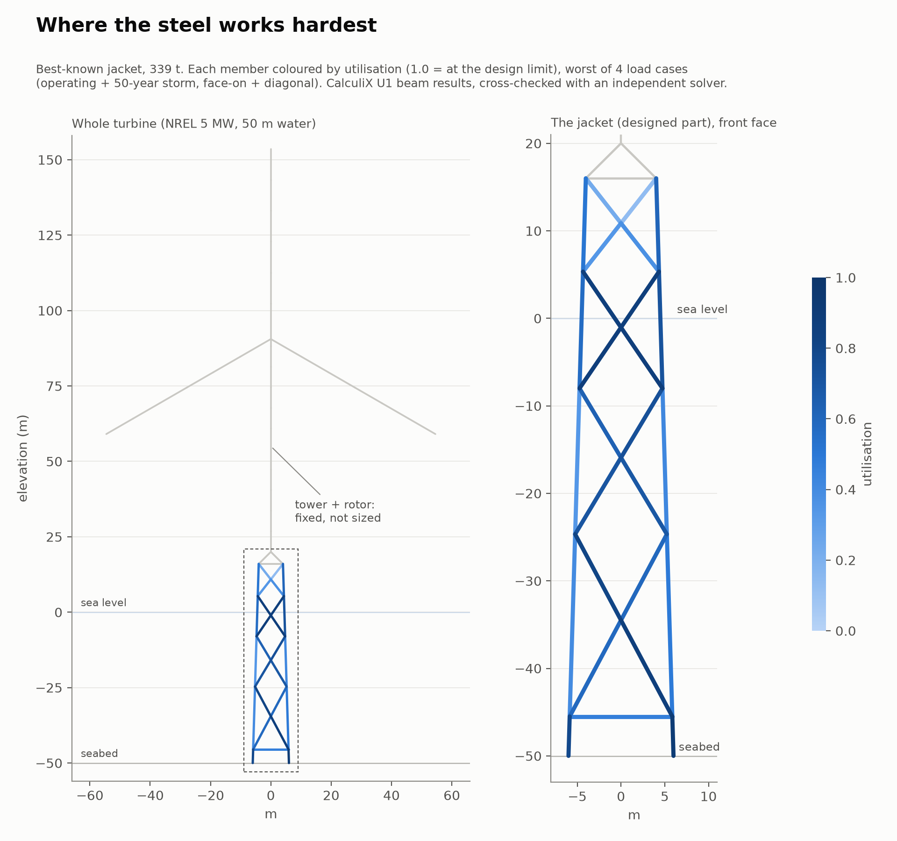
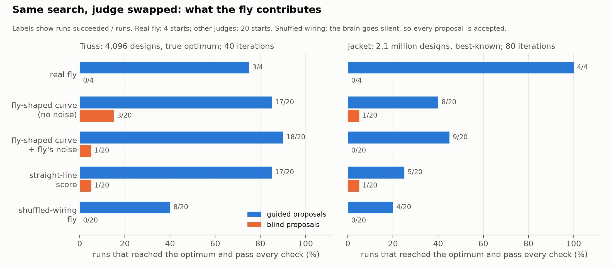

# A connectome-constrained model of the *Drosophila* feeding circuit as the selection rule in discrete structural sizing

*Technical report, October 2026. Code, models, logs and every simulated neuron recording referred to here are in this repository.*

## Abstract

We use a whole-brain leaky integrate-and-fire (LIF) model of the adult fruit fly, built from the FlyWire connectome (139,248 neurons, 2.7 million connections), as the only decision rule in a discrete structural sizing search.

**Method.**
- For each member group of a candidate design, the finite-element utilisation is converted into firing rates of the gustatory receptor neurons: utilisation drives sugar-sensing neurons, overstress drives bitter-sensing neurons.
- The firing rate of the proboscis motor neuron MN9 is read out and summed over groups. A greedy (1+1) search keeps a proposed design if its summed MN9 rate is at least that of the incumbent.
- The simulated fly is never given mass or any explicit objective.

**Results.**
- **Truss** (16 bars, 4 groups, 4,096 designs, known optimum 96.9 kg): the search reaches the global optimum from 3 of 4 starts.
- **Offshore wind-turbine jacket** of OC4 type (CalculiX beam model, four factored ultimate load cases, 7 groups, 2.1 × 10⁶ designs): it reaches the best design found by differential evolution and by a stress-ratio resizing rule (339.3 t) from all 4 starts, within 9 to 69 finite-element analyses, against 1,796 for differential evolution. It never accepted a design with an overstressed member.

**Ablation.**
- **Rewiring:** degree-preserving rewiring of the connectome abolishes the response entirely (MN9 = 0 Hz for all inputs). The behaviour used here is a property of the specific wiring.
- **Proposals:** most of the search efficiency comes from proposals informed by the finite-element result. With blind proposals every judge performs worse; the real fly with blind proposals ended 16-79 % above the best-known jacket. A smooth surrogate of the fly's response, with or without its measured noise, performs comparably to the fly on the truss. On the jacket the fly succeeded from 4 of 4 starts and the surrogates from 2 of the same 4, too few to separate them.
- **Interpretation:** the fly contributes a fixed, evolved, concave-saturating preference with a hard veto. It is not a better optimiser than standard methods, and we do not claim it is.

## 1. Introduction

The publication of a complete synaptic wiring diagram of an adult *Drosophila melanogaster* brain (Dorkenwald et al. 2024; Schlegel et al. 2024) was accompanied by a simulation showing that a simple LIF model built directly from that diagram reproduces several sensorimotor behaviours without fitting any neuron-specific parameters (Shiu et al. 2024).

The clearest of these is the feeding decision:
- activating sugar-sensing gustatory receptor neurons (GRNs) excites the motor neuron MN9, which extends the proboscis;
- co-activating bitter-sensing GRNs suppresses it.

That is a two-input decision rule, "eat or reject", produced by the wiring of the circuit.

Structural sizing has a closely analogous decision at its core. Given two candidate designs, prefer the one whose members are used more fully, provided no member exceeds its design resistance. Engineering methods encode this preference explicitly, for example as a penalised mass objective or a fully-stressed-design update.

Here we ask a narrow question. **Can the evolved feeding circuit, used unchanged, serve as the preference function in a sizing search, and what exactly does it contribute?**

The study is a demonstration, not a proposal for a practical optimiser. One evaluation of the fly takes about 10 s of CPU time; a conventional optimiser evaluates the same preference in microseconds. The interest lies in using a biological decision circuit as a component whose behaviour can be measured, characterised and ablated like any other.

## 2. Methods

### 2.1 Whole-brain model

The simulation uses the `flypoke` implementation of the Shiu et al. (2024) model on FlyWire release 783 (proofread neurons; 139,248 neurons).

**Connectivity.** Connections with fewer than 5 synapses are discarded, leaving 2,700,429 directed edges. Each edge weight is the synapse count, signed by the predicted neurotransmitter of the presynaptic neuron: GABA and glutamate inhibitory, all others excitatory.

**Neuron model.** Each neuron is a current-based LIF unit:

| Parameter | Value |
|---|---|
| resting / reset potential | −52 mV |
| threshold | −45 mV |
| membrane time constant | 20 ms |
| synaptic time constant | 5 ms |
| refractory period | 2.2 ms |
| synaptic delay | 1.8 ms |
| weight per synapse | 0.275 mV |
| time step | 0.1 ms |

There is no plasticity and no fitted parameter.

**One evaluation** (a "poke"):
- drives a chosen set of GRNs with independent Poisson spike trains at a chosen rate, for 1 s of simulated time;
- records the firing rate of MN9 (right hemisphere, FlyWire root 720575940660219265).

The input populations are the 129 neurons annotated as sugar/water GRNs and the 65 annotated as bitter GRNs.

**Seeds and cost.** The random seed fixes the Poisson input, so a poke is deterministic given (inputs, seed). Identical requests are served from a cache, and every poke is logged with its seed. One poke takes 10-14 s on a 6-core laptop CPU; three worker processes give a 1.7× throughput gain (memory-bound).

**Reproduction check.** The published result is reproduced exactly: sugar 150 Hz gives MN9 150.0 Hz; adding bitter 150 Hz gives 14.4 Hz.

### 2.2 Characterising the response before using it

**Phase 2 sweep (single seed).**
- **Sugar** (0-200 Hz): MN9 silent below about 25 Hz, rising steeply to about 100 Hz at 50 Hz input, saturating near 150-160 Hz.
- **Bitter** at sugar 150 Hz: graded suppression of MN9, from 146 Hz (no bitter) to 14 Hz (bitter 150 Hz) and 0-1 Hz (bitter 175-200 Hz).
- **Trial-to-trial noise:** ±4-7 Hz.

**Repeat with 5 seeds.** The sugar response was re-measured with 5 seeds (30-130 Hz in 10 Hz steps). The useful quantity is the gain per 10 Hz of input, divided by its standard deviation over paired seeds:
- **2.5-2.8 between 30 and 50 Hz**
- **0.2-0.8 above 80 Hz**

The single-seed sweep had overstated the slope at the top of the range. As shown below, this distinction decided whether the search worked (Figure 1).

*Figure 1. Left: MN9 rate against sugar-GRN drive, 5 seeds (mean and range). The shaded blue band is the input range used in the final encoding; the grey band is the range used by an earlier encoding that failed. Right: MN9 against bitter-GRN drive at sugar 150 Hz.*

### 2.3 Encoding structural utilisation as taste

For each design the finite-element model gives the utilisation of every member; utilisation of a member group, u_g, is the largest member utilisation in that group over all load cases.

**One poke per group.** Each group is presented to the fly in a separate poke and the design score is S = Σ_g MN9_g. An earlier attempt to present the whole design in one poke failed: MN9 saturates, so three well-used groups and four well-used groups taste the same. Summing over groups is done in Python, not by the fly.

**Truss encoding (v3.1):**
- sugar = 40 + 85·min(u_g, 1) Hz;
- bitter = 0 if u_g ≤ 1, otherwise min(60 + 1500(u_g − 1), 200) Hz.

The 60 Hz floor was added after an earlier version accepted a 1.5 % overstress: 23 Hz of bitter cost less MN9 than the sugar gained by working the member harder.

**Jacket encoding (v5):**
- sugar = 30 + 50·min(u_g, 1) Hz, placing the whole utilisation range on the steep part of the measured response;
- if any group has u_g > 1, every group's poke receives bitter 200 Hz.

The consequences of the global bitter rule:
- A design with any overstressed member therefore scores about 0 Hz in total, against 700-1,000 Hz for passing designs, independent of noise.
- Two failing designs are indistinguishable to the fly. In practice this never matters, because every search starts from, and keeps, a passing design.

**How v5 was arrived at.** An intermediate encoding (v4) mapped utilisation concavely onto 40-125 Hz to favour designs with balanced utilisation. A pre-registered check with real pokes (5 seeds) showed it could not resolve a one-catalogue-step reduction at high utilisation (−1.4 Hz, against a predicted +6 Hz), because that input range lies on the flat part of the response. v5 was then chosen from the 5-seed curve. The same check gave:
- +9.2 Hz (high utilisation) and +10.6 Hz (low utilisation) for a one-step lighter design, positive on 5 of 5 seeds in each case;
- 0 Hz on all seeds for a design with one group 2 % overstressed.

A preference for balanced utilisation at equal mean utilisation could not be detected above noise when all seven groups change at once.

Inputs are quantised to 0.5 Hz so that unchanged groups reuse cached pokes.

### 2.4 Search procedure

A multi-start greedy (1+1) search (`flyfea/optimise/search.py`). At each iteration, for each start:

1. **Propose** a neighbouring design.
   - *Guided proposals* use only the per-group utilisations of the incumbent:
     - with probability 0.55, shrink one group by one catalogue step, chosen with probability proportional to its spare capacity (1 − u_g);
     - with probability 0.20, move every group one step toward the section whose area is A·u_g/0.9 (a stress-ratio resizing step);
     - otherwise make a random move;
     - if any group is overstressed, grow the worst group with probability 0.8.
   - *Blind proposals* are random: one group ±1 step, or one group +1 and another −1 (probability 0.35).
2. **Analyse** the proposal with the finite-element model.
3. **Judge.** Score incumbent and proposal on the same random seed. The seed rotates every 5 iterations, so noise is partly shared.
4. **Race.** If the scores differ by less than a racing band (8 Hz for 4 groups, 11 Hz for 7), score both again on a fresh seed and decide on the sum.
5. **Accept** the proposal if its score is at least the incumbent's.

The search never uses mass. Mass is recorded only for evaluation.

### 2.5 Structures and finite-element models

**Truss.**
- Geometry: a 9 m × 3 m, three-bay planar truss with crossed diagonals in every bay (16 bars, statically indeterminate to degree 3), pinned and roller supported, with two 50 kN loads.
- Groups: bottom chord, top chord, verticals, diagonals. Each group takes one of 8 areas (100-1,650 mm², steps of about ×1.5).
- Design limit: allowable stress 200 MPa.
- Optimum: exhaustive enumeration of all 4,096 designs gives 96.9 kg.
- Solvers: a numpy direct-stiffness solver, and CalculiX 2.22 (T3D2 elements; axial stress from the solver's stress tensor). The two agree to 5 × 10⁻⁸ in member force. The complete 40-iteration fly search reproduced identically with either solver.

**Jacket.** A four-legged OC4/UpWind-type jacket generated from the Häfele et al. (2018) parameters:
- foot radius 8.485 m, head-to-foot ratio 0.67 (12 m to 8 m square);
- four X-braced bays with height ratio 0.8;
- mud braces 4.5 m above the mudline;
- 50 m water depth;
- a stiff transition piece at +20 m;
- a tapered 68 m tower carrying the NREL 5 MW rotor-nacelle mass (350 t);
- fixed at the mudline.

Rotor blades are present in the model as massless, unloaded beams for visualisation only.

**Material and resistances.** S355 steel (E = 210 GPa, ρ = 8,500 kg/m³ including secondary steel as in OC4).
- **Strength check (every member):** (|N|/A + |M|/W) / (355 MPa / 1.1).
- **Compression members** also receive an ISO 19902-style column check:
  - λ̄ = KL/(πr)·√(f_y/E);
  - F_c = f_y(1 − 0.278 λ̄²) for λ̄ ≤ 1.34, otherwise 0.9 f_y/λ̄²;
  - interaction σ_c/(F_c/1.18) + 0.85/(1 − σ_c/F_e)·σ_b/(f_y/1.05);
  - K = 1.0 for legs and 0.8 for braces.

**Loads.** Two factored ultimate load cases, each applied with wind and waves co-directional at 0° (face-on) and 45° (diagonal): four static steps.
- **Operating extreme** (in the manner of IEC DLC 1.6): rated thrust × gust factor, rotor torque, severe sea state.
- **Parked storm** (DLC 6.1): 50-year wave of height 18 m, period 13 s; parked-rotor drag; 50 m/s reference wind on the tower.
- **Wave and current loads** are computed with Morison's equation (C_d = 1.0, C_m = 2.0 as in OC4) using Airy kinematics with Wheeler stretching. The wave is stepped through 36 phases and the phase of maximum base shear is kept. Current is 1.0 m/s at the surface with a 1/7 power profile.
- **Other loads:** marine growth 100 mm, buoyancy of sealed members, self-weight.
- **Factors:** 1.35 on environmental and 1.0 on permanent loads.
- All loads are assembled as nodal forces in Python and applied in CalculiX.

**Design variables.** Seven groups:
- lower legs and upper legs: 8 tubes each, D 0.60-1.78 m at D/t = 25;
- mud braces and the X-braces of each of the four bays: 8 tubes each, D 0.24-0.74 m at D/t = 40.

Area steps are about ×1.37. This gives 8⁷ = 2,097,152 designs.

**Beam elements, and why U1.** CalculiX offers B31/B32R beams with a PIPE section, which it expands internally into 20-node solid elements. On a 1 m × 30 mm pipe cantilever the axial stiffness of this expansion depended on element length: −1.6 %, −3.5 %, −9.3 % and −29 % at 2, 4, 8 and 16 elements. On the jacket it produced axial forces of the wrong sign in the bracing under a single horizontal load. It was therefore used only for display.

The analysis model uses CalculiX's built-in U1 user element, a two-node Timoshenko beam with six degrees of freedom per node, with the section given as A, I, J and a shear factor of 0.5. Several properties of U1 were established by test and are handled in code:
- **Section forces:** the two printed values per element are averaged, which gives exact element-midpoint axial force and moments; the printed torque is half the true value; the printed shear and the printed reactions are not usable.
- **Orientation:** the orientation vector must be exactly perpendicular to the member, or the element stiffness is wrong. This error was found by the cross-check described next, after equilibrium checks had passed.
- **Unsupported:** there are no body forces, and no buckling or frequency analyses.
- **Accuracy** against hand calculations: section forces exact in simply supported, fixed-fixed and inclined 3D cantilever cases; deflections within 0.4-3 % at an element length of 0.66 D, converging as O(le²).

The mesh uses element length ≤ 0.6 D, giving 2,874 elements, and is fixed for all designs. One analysis (four static steps) takes 1.25 s.

**Independent verification.** A separate 3D Timoshenko frame solver written in numpy, on the same mesh and loads, agrees with CalculiX within 0.36 % in group utilisation, and within 0.035 % (axial) and 0.53 % (moment) element by element. Equilibrium of the CalculiX solution closes to 0.001 %.

**Natural frequency.** The first natural frequency of tower, jacket and rotor-nacelle mass, with lumped steel, marine-growth and hydrodynamic added mass, is computed with the numpy model. It ranges only from 0.21 to 0.38 Hz over the whole catalogue because the tower dominates. The best design has f₁ = 0.305 Hz, inside the soft-stiff window of 0.222-0.314 Hz (1P and 3P of the NREL 5 MW rotor with 10 % margins). It is reported, not used by the search.

### 2.6 Reference methods

- **Truss:** exhaustive enumeration.
- **Jacket** (reference methods all see mass directly):
  - a stress-ratio resizing loop followed by a discrete local descent;
  - scipy differential evolution (population 15 × 7, 30 generations, any failing design penalised above the heaviest passing design);
  - 2,000 uniformly random designs.

The lightest passing jacket found, 339.3 t, was found independently by the resizing loop and by differential evolution. It is the *best-known* design, not a proven optimum.

### 2.7 Ablation

The search procedure is held fixed and one component is replaced at a time.

**Judges:**
- **A1, the fly** as above;
- **A2, a noise-free surrogate:** S = Σ_g m(s_g)·b(b_g)/b(0), with m the measured mean sugar response and b the measured bitter response, interpolated;
- **A3, A2 with noise:** Gaussian noise with the measured per-poke standard deviation at that input, made deterministic per (input, seed) like the real fly so that unchanged groups cancel between incumbent and proposal;
- **A4, a linear score:** S = Σ_g u_g with the same veto (any u_g > 1 rejects), i.e. no saturation and no fly;
- **A5, the fly with a degree-preserving shuffled connectome.** The postsynaptic index of every edge is randomly permuted; each edge keeps its presynaptic neuron, synapse count and sign. In- and out-degree of every neuron are preserved, apart from 0.29 % of edges that coincided after rewiring and were merged. Three independent shuffles were tested with 3 seeds each.

**Proposals:** guided and blind.

**Design of the comparison.**
- Surrogate arms: 20 starts each (the 4 starts used for the real fly plus 16 random passing designs), 80 iterations.
- Success: the final design passes every check and is within 1 % of the optimum (truss) or best-known design (jacket).

## 3. Results

### 3.1 Truss

**The early encodings failed, for measured reasons.**
- Mean utilisation as a single taste moved the input by about 1.5 Hz per catalogue step, below the noise.
- Maximum utilisation was blind to non-governing groups.

**Per-group tasting with guided proposals reached the global optimum (96.9 kg) from 3 of 4 starts**, at the 11th analysis from the heaviest start. The 4th start finished at 118.9 kg after a noise-driven neutral acceptance at iteration 38.

**With blind proposals,** two 50-analysis runs ended at 111.3 kg and 192.1 kg. The first equals scipy differential evolution on the same budget. Random search had a median of 150.5 kg. A later 4-start blind run reached 147.9 kg at best.

The complete 40-iteration guided run was repeated with CalculiX in place of the numpy solver: every proposal, score and acceptance was identical.

### 3.2 Jacket

**Reference methods.**
- The resizing loop reached 339.3 t in 3 analyses.
- Differential evolution found the same design, first coming within 1 % of it at evaluation 1,796 of 3,255.
- Only 6.8 % of random designs passed all checks; the lightest of 2,000 was 378.3 t.
- An OC4-like sizing (legs 1.30 m × 52 mm, braces 0.74 m × 18.5 mm) weighs 676.1 t at a maximum utilisation of 0.83.

**The fly with guided proposals** started from 1,074 t, 676 t, 679 t and 867 t. All four searches ended on the best-known design [4, 2, 0, 4, 3, 2, 0] (339.3 t). They came within 1 % after 9, 40, 47 and 69 analyses (Figure 2). Two of the four needed more than the first 40 iterations; they were continued for 40 more iterations on fresh seeds.

Totals: 1,293 pokes, 56 + 18 races, 97 min. No design with an overstressed member was ever accepted. The final design has group utilisations 0.92, 0.73, 0.48, 0.87, 0.78, 0.88 and 0.39. The mud braces and the top-bay braces are at the smallest catalogue section and are lightly loaded (Figure 3).

*Figure 2. Lightest passing jacket held, against finite-element analyses used (log scale), for the fly (4 starts), differential evolution, random search (median and 10-90 % band of 300 bootstrap orderings) and the resizing loop.*

*Figure 3. The best-known jacket (339.3 t): member utilisation, worst of the four load cases. CalculiX U1 results.*

### 3.3 Ablation

**Rewired connectome (A5).** The intact brain responded to sugar 40, 80 and 150 Hz with MN9 67, 125 and 151 Hz, and to sugar + bitter with 18 Hz. All three shuffled brains gave **MN9 = 0 Hz for every input**, although MN9 kept its 91 input connections and every neuron kept its degree. As a judge, a silent brain scores every design zero; the (1+1) rule then accepts every proposal, which is a random walk without a veto.

**Search ablation.** Success counts runs whose held design passes every check and is within 1 % of the optimum (truss) or best-known design (jacket). The real fly has 4 starts; every other judge has 20, the same 4 plus 16 random passing designs. The truss is compared at 40 iterations (the length of the real-fly truss runs; 80 in brackets), the jacket at 80 (Table 1, Figure 4).

*Table 1. Success by judge and proposal mechanism.*

| Judge | Truss, guided | Truss, blind | Jacket, guided | Jacket, blind | Runs ending on an overstressed design |
|---|---|---|---|---|---|
| A1 fly | 3/4 | 0/4 | **4/4** | 0/4 (final 392-607 t) | 0 |
| A2 surrogate | 17/20 (17/20) | 3/20 (15/20) | 8/20 | 1/20 | 0 |
| A3 surrogate + noise | 18/20 (19/20) | 1/20 (5/20) | 9/20 | 0/20 | 0 |
| A4 linear | 17/20 (17/20) | 1/20 (8/20) | 5/20 | 1/20 | 0 |
| A5 shuffled connectome | 8/20 (6/20) | 0/20 (0/20) | 4/20 | 0/20 | 18/40 truss, 27/40 jacket |

On the four jacket starts shared with the fly, the surrogates A2 and A3 each reached the best-known design from 2 of 4. With n = 4 this is not distinguishable from the fly's 4 of 4.

*Figure 4. Fraction of runs that reached the optimum (truss) or best-known design (jacket) and pass every check, by judge and proposal mechanism.*

## 4. Discussion

**What the fly contributes.** In this setting the fly is a fixed function from two inputs (sugar and bitter drive) to a scalar (MN9 rate), with three relevant properties:
- it is concave and saturating in the reward input;
- it imposes a graded veto from the penalty input;
- it is noisy, at ±4-12 Hz per evaluation depending on input.

Summing that function over member groups gives an objective that increases with utilisation and is maximised near the fully stressed boundary. That is why the search moves toward light designs without ever being told mass. The specific curvature, saturation and veto strength come from the connectome; the rewiring control shows they are not generic properties of a network of this size and degree distribution.

**What it does not contribute.** The ablation separates the judge from the proposal mechanism.
- **Proposals carry most of the efficiency.** With guided proposals, every judge that keeps the veto reaches the truss optimum in 85-90 % of runs. With blind proposals, none does better than 15 % within 40 iterations.
- **On the larger jacket** every judge does worse. The saturating surrogates (A2, A3: 40-45 %) beat the linear score (A4: 25 %), which agrees with the argument above that saturation favours raising the least-used group.
- **The veto is essential.** Without it (A5), runs end on overstressed designs in 45 % (truss) and 68 % (jacket) of cases.
- **Summary.** The fly is best understood as a noisy evaluation of a saturating preference with a veto. Once its response curve has been measured, its role in the search is largely reproduced by a few lines of code. What cannot be reproduced without the measurement is the particular shape of that curve, which is a property of the wiring.

**On noise.** Noise had two opposite effects.
- **Blind search:** it causes wrong decisions near ties. On the truss, adding the measured noise to the surrogate lowered blind success at 80 iterations from 15/20 to 5/20.
- **Guided search:** it allows neutral moves that sometimes escape plateaus, but also moves away from an optimum already reached (one A3 run reached 339.3 t at iteration 74 and left it).

Whether noise is a cost or a benefit therefore depends on the proposal mechanism. The present data do not show a net benefit.

**Encoding is the main engineering task.** Most of the effort went into choosing what to present to the fly and on what scale. The response saturates, so presenting many groups in one evaluation fails. The flat top of the sugar response hides small differences, so a mapping onto that range fails even though it looks reasonable on a single-seed curve. In each case the failure was found by measuring the circuit before relying on it, and the fix followed from the measurement.

## 5. Limitations

- **Statics only.** No fatigue, joint (punching shear) or dynamic checks, although fatigue usually governs offshore wind jackets. Frequency is reported, not constrained.
- **Coarse catalogues.** The catalogues are deliberately coarse (×1.37-1.5 area steps) so that one step is resolvable by the fly.
- **Not proven optimal.** The jacket reference is the best-known design, not a proven optimum.
- **The connectome.** The connectome is one female brain; neurotransmitter signs are predicted, and the LIF model has no plasticity or neuromodulation.
- **Cost.** About 10 s per poke; a 4-start, 40-iteration jacket search takes about an hour.
- **Starting point.** Every search must start from a passing design: with the global bitter rule the fly cannot rank two failing designs.

## 6. Reproducibility

- **Code:** `flyfea/` (brain, fea, optimise) and `scripts/`.
- **Every poke** is in `logs/fly_calls*.jsonl` with its inputs, seed and result; every jacket analysis is in `logs/jacket_solves.jsonl`.
- **CalculiX decks:** `models/`.
- **Seeds** are fixed in the scripts (truss fly search 6000+, jacket 7000+, continuation 7500+, blind fly 7700+/7800+, checks 7100+/7200+, shuffles 1-3 with pokes 8000+).
- **External software and data:** see `THIRD_PARTY.md`; the brain data are downloaded by flypoke on first use.

## References

- Dorkenwald S, et al. (2024). Neuronal wiring diagram of an adult brain. *Nature* 634, 124-138.
- Schlegel P, et al. (2024). Whole-brain annotation and multi-connectome cell typing of *Drosophila*. *Nature* 634, 139-152.
- Shiu PK, et al. (2024). A *Drosophila* computational brain model reveals sensorimotor processing. *Nature* 634, 210-219.
- Jonkman J, Butterfield S, Musial W, Scott G (2009). Definition of a 5-MW reference wind turbine for offshore system development. NREL/TP-500-38060.
- Vorpahl F, Popko W, Kaufer D (2011). Description of a basic model of the "UpWind reference jacket" for code comparison in the OC4 project under IEA Wind Annex 30. Fraunhofer IWES.
- Vorpahl F, Popko W (2013). Description of the load cases and output sensors to be simulated in the OC4 project under IEA Wind Annex 30. Fraunhofer IWES.
- Häfele J, et al. (2018). A jacket topology and geometry model for preliminary design studies and optimization. *Wind Energy Science* 3, 553-572.
- ISO 19902 (2020). Petroleum and natural gas industries: Fixed steel offshore structures.
- Morison JR, O'Brien MP, Johnson JW, Schaaf SA (1950). The force exerted by surface waves on piles. *Petroleum Transactions, AIME* 189, 149-154.
- Wheeler JD (1970). Method for calculating forces produced by irregular waves. *Journal of Petroleum Technology* 22, 359-367.
- Storn R, Price K (1997). Differential evolution: a simple and efficient heuristic for global optimization over continuous spaces. *Journal of Global Optimization* 11, 341-359.
- Dhondt G. CalculiX CrunchiX user's manual, version 2.22.

*Reference details should be checked against the original sources before publication.*
