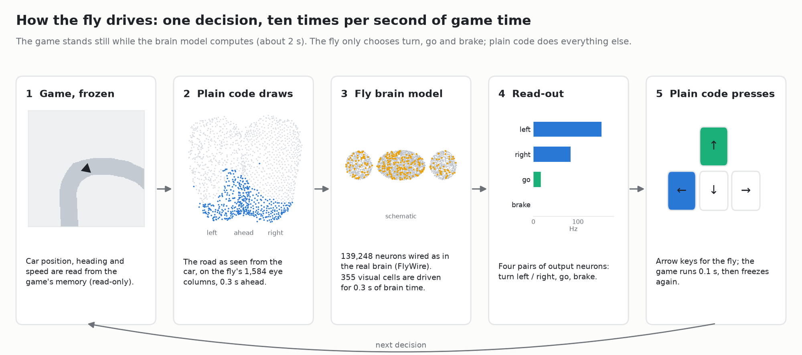
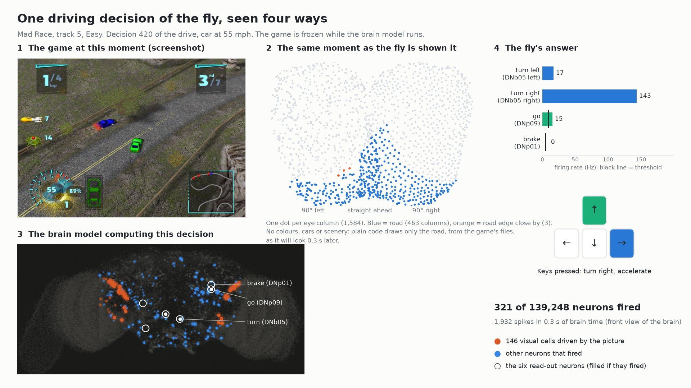
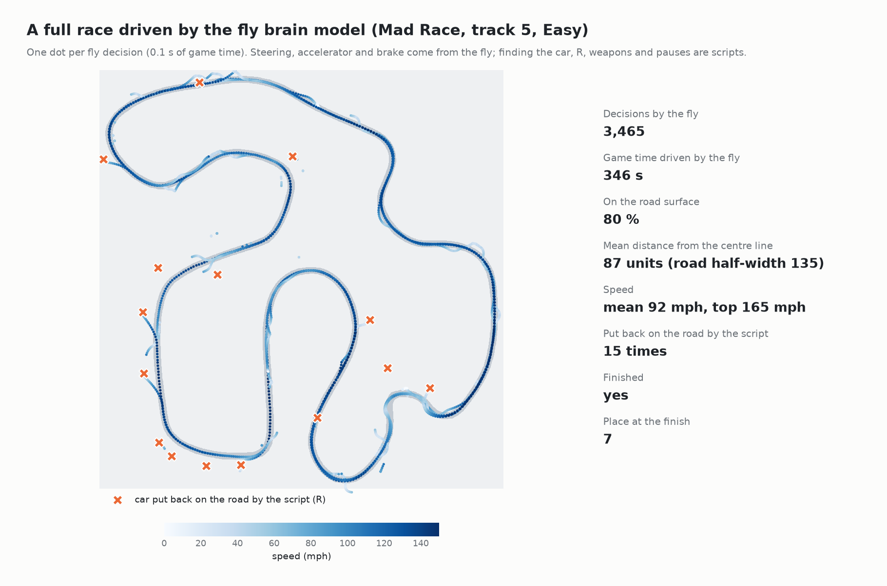
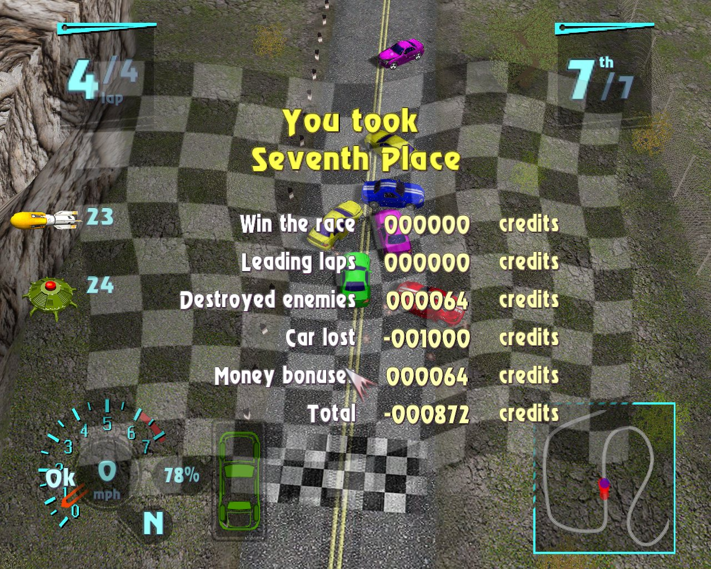
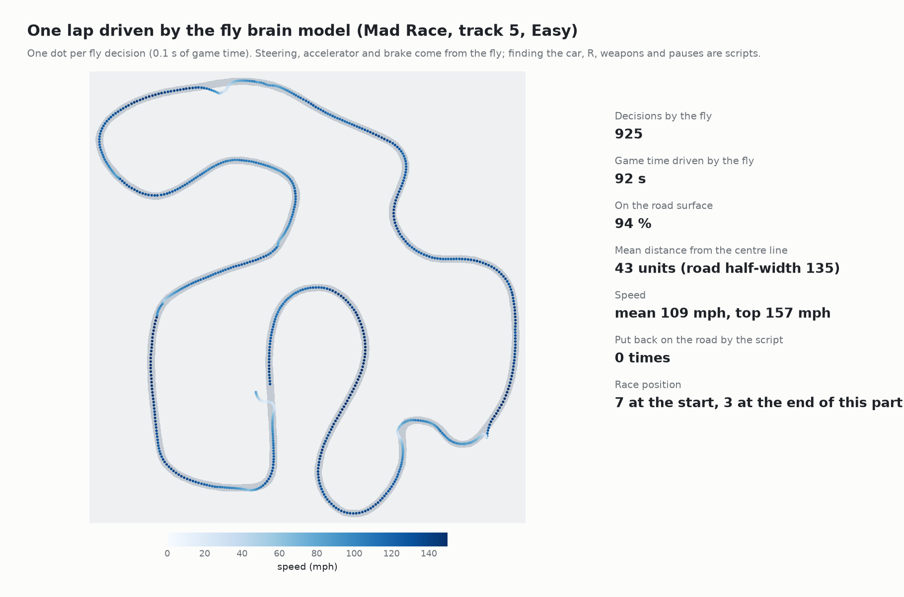

---
# DRAFT, adapted from the share package's write-up (mad-race-fly_writeup.md, final state 2026-11-20).
# Every number is as written there. Rewrite the first and last paragraph in your own words.
title: "A simulated fruit-fly brain steers a car in a racing game"
summary: "A fly brain model, shown a picture of the road, chooses turn, go and brake for a car in a racing game, one frozen step at a time."
status: built
kind: fun
# Closest existing field until the "kind" entry exists in src/content.config.ts.
fields: ["Engineering automation"]
date: "2026-11-20"
result: "Finished one full race, 7th of 7, with 15 resets by a script"
numbers:
  - value: "3,465"
    label: "Decisions by the fly in the finished race, every one with the game frozen"
  - value: "80.6 %"
    label: "Of those decisions on the road surface"
  - value: "92.5 s"
    label: "Best clean lap (race r1): 7th to 3rd, no reset"
featured: true
cover: "./figures/race-map-r6.png"
coverAlt: "Track map of the finished race, one dot per decision coloured by speed, with a cross at each of the 15 resets"
caption: "The finished race r6: 3,465 decisions coloured by speed. Each cross is a reset by the script."
preview: "./figures/one-decision-pipeline.png"
tags: ["Python", "Connectome", "Spiking neural model", "Game automation"]
---

# A simulated fruit-fly brain steers a car in a racing game

<!-- DRAFT: rewrite the first and last paragraph in your own words. -->

Work ran from 18 to 20 Nov 2026 and is closed. Results as of 20 Nov 2026 (final).

**Read this first.** Three things keep this honest:

1. **Plain code does the heavy work.** It reads the car's position from the game, draws a picture of the road from the game's road data, freezes the game for every decision, and turns the answer into key presses with a model of the car's steering wheel. The fly brain model only chooses between turn left or right, accelerate, and brake.
2. **This is not real-time driving.** The game is frozen for every decision. The brain model needs about 2 s of computing for each 0.1 s of game time. The videos are played back at game speed.
3. **One full race was finished, in last place, and it was not a clean race** (20 Nov 2026). The fly's car finished 7th of 7. On the way a script put it back on the road 15 times, and the car was destroyed twice. The best clean driving is still one lap of an earlier race.

## The question

An earlier project used a simulated fruit-fly brain as the judge in a structural sizing loop, through the fly's taste circuit (see the [FEA write-up](/projects/fly-fea/)). The question here: can the same brain model, through its visual network, drive a car in a PC racing game (Mad Race, a top-down arcade racer)? The division of labour is the same as before. Plain code does everything that needs engineering. The fly does one simple thing.

## How it works, from first principles

### The brain model

The model is the published whole-brain simulation of Shiu et al. (2024) on the FlyWire wiring diagram: 139,248 neurons, each a leaky bucket with a tripwire. Charge flows in from other neurons and leaks away; above a threshold the neuron sends one pulse (a spike) to the neurons it connects to. Nothing is trained. To ask it a question, some input neurons are made to fire at chosen rates (in spikes per second, Hz), the model runs for a short stretch of simulated time, and the firing of some output neurons is counted.

### Where the picture goes in

The obvious way, light into the eye's photoreceptors, does not work in this model. An earlier test measured that: the first stages of the fly's visual system do not use spikes, and this model has only spiking neurons. So the picture has to enter deeper, at the **output cells of the optic lobe**. These are the cells that carry the result of the fly's early visual processing into the central brain, and they do spike. Plain code stands in for everything before them.

### First gate: does the model steer at all?

Before building anything, one question had to be answered by measurement. If the output cells of one eye are driven, does a left-right difference appear on the **descending neurons**, the neurons that carry commands from the brain to the body?

It does. I screened 63 groups of output cells and recorded all 1,303 descending neurons. Three pairs were chosen:

| Job | Input cells driven by the picture | Output neuron read | Measured |
|---|---|---|---|
| Turn | LPLC4 | DNb05, right and left | The neuron on the driven side fires, in proportion to the drive, up to about ±320 Hz; nearly unbiased with equal eyes |
| Go | LC31a | DNp09 | Graded, 35 to 160 Hz |
| Brake | LPLC2 | DNp01 (the giant fibre, an escape neuron) | Graded, 48 to 189 Hz |

The sign is "same side": more drive on the right eye makes the right neuron fire, which is read as "turn right". The fly turns toward what it sees. So the thing to show it is the road.

With the wiring shuffled (same neurons, same number of connections each, random partners) these neurons stay at 0 to 13 Hz. The steering response is in the specific wiring.

Two caveats belong here. The pathway known from the literature for steering toward objects (LC10 cells to the neuron DNa02) was also tested; in this model it is pulled strongly to the left even with equal eyes, so it is only logged. And calling DNb05 a "steering neuron" is this project's assignment, not an established fact about the real fly.

### The fly's-eye picture

- **Where each cell looks.** A fly's eye has roughly 790 columns, its pixels. Which direction each column looks in was recovered from the wiring diagram itself (a cell looks where its input cells look). The order and neighbourhood of the columns come from the data; the absolute angles are a nominal choice of this project.
- **What is drawn.** Plain code takes the road surface from the game's own track files and the car's position and heading from the game's memory (read-only). The fly is placed on the car, looking along its nose. Each eye column is set to "road" if its line of sight meets the road surface, and to "road edge close by" if it meets ground that is not road within a short distance. Nothing else is drawn: no colours, no other cars, no scenery. The model never sees the screen.
- **How it becomes input.** Each input cell averages the columns it is wired to, and that value sets its firing rate.

### From the answer to the keys

The brain model runs for 0.3 s of simulated time per decision (a 0.3-s trial gives the same steering answer as a full second; correlation 0.996). Then:

- **Turn** = rate of the right DNb05 minus rate of the left one.
- **Go** while DNp09 fires at 9 Hz or more.
- **Brake** while DNp01 fires at 5 Hz or more; brake wins over go; no braking below 30 mph.

In words: the fly turns toward the side with more road, accelerates while it has road beside it, and brakes when the road's edge is close. Plain code turns these three values into arrow-key presses. Scripts, not the fly, do everything else: starting the race, finding our car in the game's memory, the reset key, the weapons, the pauses.

*One real decision from the lap (decision 420). The brain activity panel is a re-run of the logged decision with the same picture and seed; it gave exactly the read-out of the live run.*

## What was measured

### Without the game (the "headless" test)

A simple car model on the real road geometry, with the fly in the loop, ten decisions per second of game time. Twelve stretches on three tracks: straights, gentle bends, sharp corners and recovery starts.

| Driver | Stretches driven | Time on the road surface |
|---|---|---|
| Fly, intact wiring | 12 of 12 | 100 % |
| Script that knows the centre line | 12 of 12 | 92 % |
| Fly with shuffled wiring | 0 of 12 | 55 % |
| No steering | 0 of 12 | 41 % |

The car model here is not the game's physics. It shows that the loop holds the road, nothing more.

### In the game: three stages

The game runs only in real time, and one decision of the brain model takes about 2 s of computing. So the game has to stand still while the fly decides.

1. **The game's own pause key.** The game accepts a new pause only about every 0.36 s, which gives 2.4 decisions per second of game time. At that rate the car over-steers and leaves the road. Gate not passed.
2. **Freezing the game from outside** (suspending its process). This gives 10 decisions per second. A straight was held and a 110° corner was driven, but a gentle bend was lost. Best of this stage: 2 of 3. The logs showed the cause: the game's car has a steering wheel that needs about 0.25 s to reach lock, which the simple car model did not have.
3. **Look-ahead and wheel-aware keys.** Plain code now draws the picture from where the car will be 0.3 s later, and chooses key presses with its own copy of the wheel model. The fly, its read-out neurons and its thresholds were not changed.

With stage 3 the live gate passed (run s8, track 5, difficulty Easy). The fly held each stretch for 8.7 s:

| Stretch | Off the road surface | Furthest from the centre line | Speed |
|---|---|---|---|
| Straight | 0 % | 94 units | 75-149 mph |
| Gentle bend | 0 % | 69 units | 72-137 mph |
| 110° corner | 5 of 87 decisions, all in the first 0.5 s (the script handed the car over off the road) | 169 units | 34-141 mph |

The road's edge is about 135 units from the centre line. All 261 decisions were taken with the game frozen.

### The races

**State on 20 Nov 2026: one full race was finished (race r6), 7th of 7. The project was closed at this point.**

All attempts used the same set-up: single race, track 5, Easy, 4 laps, 7 cars. A script holds the accelerator at the start until it has found our car in the game's memory. Then the fly drives.

#### The finished race (r6)

| | Result |
|---|---|
| Outcome | **Finished, 7th of 7.** Last place for the whole race. The game's own results screen confirms the finish |
| Decisions by the fly | 3,465, every one with the game frozen |
| Game time | 348.9 s. On the clock: 148 min, of which 21 min in ten scheduled pauses of the driver |
| On the road surface | 80.6 % of decisions |
| Mean distance from the centre line | 88 units (the road's edge is at about 135) |
| Speed | mean 92.8 mph, top 165 mph |
| Put back on the road by the script (reset key) | **15 times** |
| Car destroyed and respawned by the game | 2 times (cause not known from the log; the opponents shoot) |
| Weapons, fired by a script and not by the fly | 37 rockets, 6 mines |
| Left out of the driving figures | 124 decisions that the driver itself marked invalid, because the position did not come from our car |

| Lap | Game time | On the road | Mean speed | Mean distance from the centre line | Resets by the script |
|---|---|---|---|---|---|
| 1 | 86.9 s | 78 % | 92 mph | 97 units | 4 |
| 2 | 92.4 s | 75 % | 82 mph | 108 units | 4 |
| 3 | 84.2 s | 80 % | 95 mph | 86 units | 5 |
| 4 | 85.3 s | 90 % | 103 mph | 61 units | 2 |

*Each cross is a reset by the script. The numbers printed beside the map count all 3,465 rows of the log (80 %, 87 units, 92 mph, 346 s); the table above leaves out the 124 invalid rows and gives the race's full game time.*

**What the 15 resets were.** They come in clusters. Sorted by what started each one:

- **5 started with the fly's own driving.** The car left the road and stayed more than 450 units from the centre line for a second. This happened once or twice a lap. It is the honest measure of the fly as a driver here: at 90 to 160 mph it does not hold the road for a whole lap every time.
- **10 came from my code, not from the fly.** After every reset a script has to find our car in the game's memory again. It does this with a wiggle test: it presses left, then right, and looks for the object in memory whose heading follows the keys.
  - 2 were at the start. The first search took an object that was not a car. The fly then drove three decisions on a position that did not move, and the car ended behind a barrier.
  - 8 were follow-ups within seconds of an earlier search. Each search held the accelerator for 3 to 4 s with no steering, which sent the car off the road again at 75 to 107 mph, or it ended on a wrong copy of the car. One of these resets was pressed while the car was driving well at 120 mph.

By the script's own reason, 12 of the 15 resets were "far from the road", 2 "on its roof" and 1 "standing still".

The longest stretches with no intervention at all were 62.6 s (to the finish line; 93 % on the road, mean 107 mph), 59.5 s (87 %, 98 mph) and 48.1 s.

A fix for the car search was written afterwards (accelerator only to get a standing car rolling; implausible answers of the wiggle test rejected). It was not tested in the game.

The last 20 s of the race, to the finish line, at game speed:

<video controls muted playsinline preload="none" poster="/media/mad-race/finish-r6-poster.jpg" width="960" height="540" style="width: 100%; height: auto;">
  <source src="/media/mad-race/finish-r6-last-20s.mp4" type="video/mp4" />
</video>

*The game is frozen for every decision; the video plays it back at game speed. The longest stretch with no reset, 62.6 s, ends at this finish line.*

*The game's own results screen at the end of race r6.*

#### The clean lap (race r1, lap 1)

The best clean driving comes from an earlier race that was not finished.

| | Result |
|---|---|
| Decisions by the fly | 925 (one per 0.1 s of game time) |
| Lap time | 92.5 s |
| Mean speed | 109 mph |
| On the road surface | 94 % of decisions |
| Mean distance from the centre line | 43 units |
| Resets by the script | none |
| Position | from 7th (last) on the grid to 3rd |

Compared with this lap, the laps of the finished race are as fast in game time (84 to 92 s) but not clean, and the place never improved: every reset costs seconds, and the first minute was lost.

#### All race attempts

| Race | Outcome | Cause |
|---|---|---|
| r1 | One clean lap, then lost | Faults in my code that pauses the game. Not the fly |
| r2, r3, r4 | Stopped; not results | The code read the position of the wrong car from the game's memory. These runs say nothing about the fly |
| r5 | Stopped by me after 10 minutes because the laptop was needed | First use of the wiggle test; no result |
| r6 | **Finished, 7th of 7**, with 15 resets and 2 cars lost | 5 resets from the fly's driving, 10 from my car-search code |

**What was not done.** The plan had one more step: weapons decided by the fly, and the shuffled-wiring control repeated in the game. The project was closed after the finished race, so neither was done. The statement that the driving depends on the specific wiring rests on the test without the game (shuffled wiring 0 of 12 stretches, intact wiring 12 of 12).

## What failed

| Attempt | What happened | What was done |
|---|---|---|
| Light into the photoreceptors (earlier project) | No signal reaches the later visual cells in this model | Picture enters at the optic lobe's output cells |
| The published steering pathway (LC10 to DNa02) | Pulled left by 144 Hz with equal eyes | Logged only; LPLC4 to DNb05 used |
| First rule for go and brake | The go neuron was lowest when driving straight; the brake neuron stayed near zero | The eye map showed why (these cells look sideways); rule changed once |
| First headless version | Braked to a standstill at the edge of two sharp corners and stayed there | No braking below 30 mph |
| Game's own pause | 2.4 decisions a second; road lost | Freeze the game from outside |
| Freeze alone | 2 of 3 stretch types | Steering-wheel delay measured; look-ahead and wheel-aware keys |
| Races r1 to r4 | Lost to my pause code (r1) and to reading the wrong car's position (r2 to r4) | Pause code hardened; car identity checked by a wiggle test |
| Car search in the finished race r6 | Held the accelerator for 3 to 4 s with no steering; once took an object that was not a car. This caused 10 of the 15 resets | Fix written, not tested in the game (project closed) |

## Honest limits

- **One finished race, and not a clean one.** One track, one difficulty (Easy). One race finished, in last place, with 15 resets by the script and 2 cars lost. One clean lap, from another race. One passing run per stretch type at the live gate. Nothing was repeated to see how often it would finish.
- **The fly does not hold the road every lap.** In the finished race 80.6 % of the decisions were on the road surface, and 5 of the 15 resets started with the fly's own driving.
- **Frozen game.** About 2 s of computing per 0.1 s of game time. Nothing here shows that a fly brain model could drive in real time.
- **The plain code is substantial.** Road picture, look-ahead, wheel model, key timing, car finding, pauses and weapons are all ordinary code. The fly decides three things per step.
- **The picture is an abstraction.** Road and road edge only, drawn from the game's files. The model does not see the screen, other cars or obstacles.
- **Reading the game's memory.** The car's position comes from the game's memory (read-only), using code from a separate bot project of mine.
- **The eye's angles are nominal**, and the left eye's map is calibrated from the right eye's.
- **The brake decision is the weakest.** Its threshold corresponds to about 3 spikes per decision. "Go" is close to "always on while a road is in view". The picture is blind when the car stands across the road.
- **Controls not repeated everywhere.** The shuffled-wiring control was run in the headless test on the simple car, not in the game. The planned test in the game was not done.
- **Presentation pictures.** The images that lay a game screenshot on the fly's eyes are a presentation aid with an approximate fit. They are labelled as such.

In all, this project made 16,330 logged runs of the brain model, every one with its seed: 562 for the steering gate, 6,763 without the game, 9,001 in the game (3,286 of them in the finished race) and 4 re-runs for the brain pictures.

## Credits and references

The wiring diagram is from the FlyWire Consortium (Dorkenwald et al. 2024; Schlegel et al. 2024), and the brain model is that of Shiu et al. (2024). Mad Race and its graphics belong to their owners; the game, its files and the connectome data are not included here. The code is not public yet.

- Dorkenwald S, et al. (2024). Neuronal wiring diagram of an adult brain. *Nature* 634, 124-138.
- Schlegel P, et al. (2024). Whole-brain annotation and multi-connectome cell typing of *Drosophila*. *Nature* 634, 139-152.
- Shiu PK, et al. (2024). A *Drosophila* computational brain model reveals sensorimotor processing. *Nature* 634, 210-219.

<!-- From the share package: check the reference details against the original sources before publishing. FlyWire licence (CC BY or CC BY-NC) still to be checked by the owner. -->
